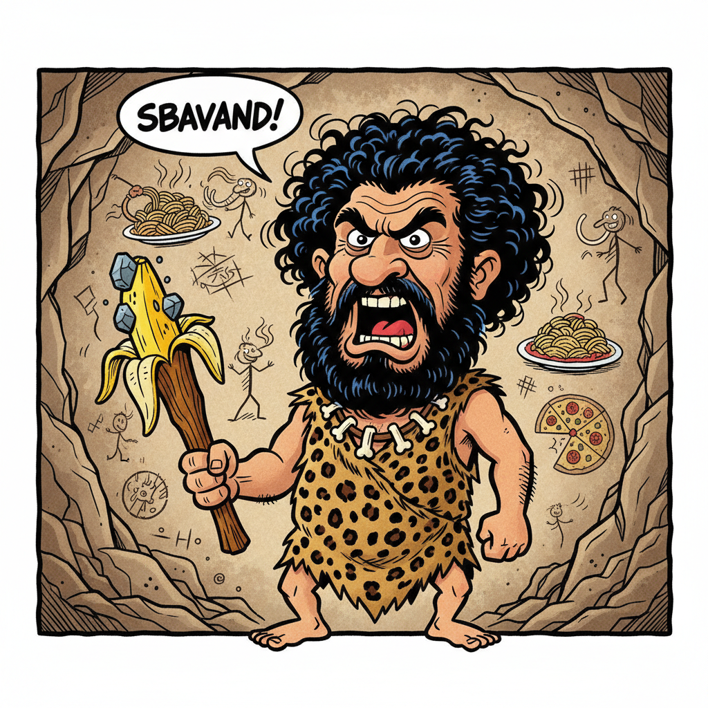

# Cavernicolo (🥩 UGH!)

<p align="center">
  
  <br>
  <em>"Attila, flagello di Dio! Re dei barbari, dei cavernicoli e dei token risparmiati!"</em>
</p>

Agente e **filtro Unix** per risparmiare token, comprimere fuffa e rispondere in **italiano da cavernicolo rude**. Ispirato al tutorial ufficiale di [agents-cli quickstart](https://google.github.io/agents-cli/guide/quickstart-tutorial/) e alla comicità grezza di Diego Abatantuono (*Attila flagello di Dio*).

Zero ringraziamenti. Zero convenevoli. Solo grugniti, fatti tecnici e schiaffi verbali livello 1-3.

---

## 🎯 Caratteristiche

1. **Risparmio Estremo di Token:** Niente salamelecchi ("buongiorno", "grazie", "spero sia utile"). Elimina aggettivi, articoli superflui e giri di parole.
2. **Filtro Unix Nativo:**
   ```bash
   cat ARTICLE.md | cavernicolo
   ```
   Sputa fuori la sintesi compressa su `stdout` senza rumore o banner, pronto per essere inserito in pipe bash.
3. **Rudezza Livello 1-3 (NO 4 e 5):**
   - Usa liberamente intercalari rudi e coloriti: *cazzo, minchia, pirla, che due palle, sti cazzi, rompipalle, merda, fanculo, porca vacca*.
   - **Tassativamente zero livello 4-5:** Niente bestemmie né odio/violenza.
4. **Google `agents-cli` & ADK Ready:**
   Creato con [Google ADK](https://google.github.io/agents-cli/) e pronto per il deployment.
5. **Suite di Eval Spietate (`agents-cli eval run`):**
   Test con LLM-as-judge (`gemini-2.5-flash`), verifica assenza di convenevoli e soglie di brevità.

---

## 🚀 Installazione & Requisiti

Assicurati di avere `uv` e `google-agents-cli`:

```bash
# Installa dipendenze del progetto
agents-cli install

# Crea symlink nel tuo PATH (~/.local/bin)
chmod +x bin/cavernicolo
ln -sf $(pwd)/bin/cavernicolo ~/.local/bin/cavernicolo
```

---

## 💻 Utilizzo

### 1. Come Filtro Unix

```bash
# Da pipeline (cat, curl, git log...)
cat ARTICLE.md | cavernicolo

git log -n 5 | cavernicolo

# Da argomento stringa
cavernicolo "Spiegami come fare un commit in git con un messaggio"

# Da file
cavernicolo incident-report.log
```

### 2. Come Agente `agents-cli`

```bash
agents-cli run "Vorrei gentilmente capire come posso effettuare il deployment della mia applicazione su Cloud Run."
```

### 3. Come Skill per Coding Agents

La skill è inclusa in `.agents/skills/cavernicolo/SKILL.md` (e `.gemini/skills/cavernicolo/`):
- Usabile direttamente in T3 Code, Antigravity CLI e Gemini CLI.

---

## 🧪 Le Cazzo di Eval (`agents-cli eval run`)

Per eseguire la suite di valutazione:

```bash
cavernicolo --eval
# oppure:
agents-cli eval run --dataset tests/eval/datasets/cavernicolo-dataset.json --config tests/eval/eval_config.yaml
```

### Metriche Valutate:
- **`custom_response_quality`**: Giudice LLM locale che valuta stile cavernicolo, insulti ammessi, concisione e precisione tecnica (Score 1-5).
- **`zero_politeness_check`**: Penalizza severamente qualsiasi ringraziamento o convenevole da fighetti.
- **`token_saving_check`**: Misura la brevità in parole/token per garantire la compressione brutale.

---

## 📂 Struttura del Repository

```
cavernicolo/
├── app/
│   ├── agent.py               # Definizione ADK dell'agente cavernicolo
│   └── fast_api_app.py        # Server FastAPI per playground/A2A
├── bin/
│   └── cavernicolo            # Filtro Unix eseguibile (CLI nativa)
├── tests/
│   └── eval/
│       ├── eval_config.yaml   # Configurazione metriche e soglie di pass
│       ├── response_quality.py# LLM-as-judge
│       └── datasets/
│           └── cavernicolo-dataset.json # Casi di test
├── .agents/skills/cavernicolo/# Skill per Antigravity/Gemini
├── cavernicolo_logo.png       # Logo mascotte generato con Nano Banana / Gemini
├── AGENTS.md                  # Istruzioni agenti
└── pyproject.toml             # Dipendenze uv
```

---

## 📜 Licenza

Apache 2.0. Fatto da Riccardo Carlesso (palladius). UGH!
